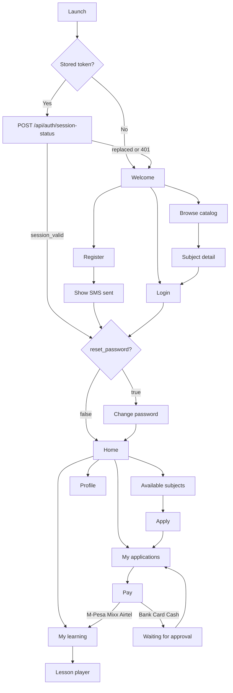

# Student mobile app flow

This guide describes how a students-only mobile app should move through registration, login, course browsing, applications, payments, and learning, and how each step talks to the African Hub API.

The API is the Flask app in `app.py`. Send JSON with `Content-Type: application/json`. After login, send the token on every protected call:

```http
Authorization: Bearer <token>
```

Most responses use this envelope:

```json
{
  "status": "success",
  "message": "…",
  "data": {}
}
```

Errors use `"status": "error"` and a `message`. Validation failures on login and password change also include `errors` and return `422`.

## What the app should store

| Key | Where it comes from | Used for |
| --- | --- | --- |
| `token` | Registration or login | `Authorization` header |
| `session_id` | Registration or login | Session check when the token is not sent |
| `user` | Registration or login | Profile, `reset_password` gate, role check |
| `reset_password` | User object | Force the change-password screen when `true` |

The server does not expire access tokens. The app owns idle timeout: clear the stored token after the student has been away for the session length you choose, then return to login.

A new login replaces the previous one. Only one device stays signed in. Poll session status while the app is open. If `another_login_detected` is `true`, clear local storage and return to login.

## Who may use the app

Self-registration always assigns the `STUDENT` role. After login, continue into the app only when `assignedRoles` contains an active role with `"code": "STUDENT"`. Anyone else should see a message that this app is for students and be signed out.

## Screen flow



Suggested tabs after login: **Subjects**, **Applications**, **Learn**, **Profile**.

1. **Welcome.** Browse the public catalog, register, or log in.
2. **Register.** Collect name, phone, and email. The server creates the password and sends it by SMS. The response also returns that password and a token. If `reset_password` is `true`, go straight to change password.
3. **Login.** Email or phone plus password. Same `reset_password` gate.
4. **Change password.** Required while `reset_password` is `true`. Block the rest of the app until this succeeds.
5. **Subjects.** List subjects the student has not applied for. Open a subject, then apply.
6. **Applications.** List the student's applications, cancel one that is still open, and start payment.
7. **Pay.** Pick a method, confirm the phone number, and submit. Mobile-money success unlocks learning. Bank, card, and cash stay pending until staff approve the application.
8. **Learn.** Show only approved subjects, then topics, subtopics, and files. Play video with progress tracking, or open a document.
9. **Profile.** Current user, payment history, change password, log out.

## Status values the UI should know

**Application status** (`status`): `pending`, `approved`, `rejected`, `waitlisted`, `withdrawn`, `verified`.

**Payment status** (`payment_status`): `pending_payment`, `paid`, `failed`, `refunded`.

**Learning access.** `GET /api/courses/approved` returns a subject only when the application `status` is `approved`. Mobile-money payments set that status immediately. Bank, card, cash, and other methods leave it `pending`, so the Learn tab stays empty until approval.

**Video watch status:** `not_started`, `in_progress`, `completed`. A video counts as completed at 90% watched.

## 1. Registration

`POST /api/self-registration`

No auth. The server hashes a random 6-digit password, creates the user with `registration_mode: "SELF"`, assigns `STUDENT`, sends the password by SMS, and returns a login token. `reset_password` is `true`, so the next screen must be change password.

Phone numbers are stored as Tanzania international form: `0755344162`, `755344162`, and `255755344162` all become `255755344162`. Later login with phone must use that stored value.

### Request

```json
{
  "first_name": "Amina",
  "middle_name": "J",
  "last_name": "Mwangi",
  "phone": "0755344162",
  "email": "amina@example.com"
}
```

| Field | Required | Notes |
| --- | --- | --- |
| `first_name` | Yes | |
| `last_name` | Yes | |
| `phone` | Yes | Digits; rewritten to `255` + last 9 digits |
| `email` | Yes | Must be unique |
| `middle_name` | No | |

### Success `201`

```json
{
  "status": "success",
  "message": "Registration successful",
  "data": {
    "token": "<jwt>",
    "session_id": "8f1c2a0e-6b44-4c1a-9d2e-1a0b3c4d5e6f",
    "user": {
      "id": 42,
      "first_name": "Amina",
      "middle_name": "J",
      "last_name": "Mwangi",
      "email": "amina@example.com",
      "phone": "255755344162",
      "status": "ACTIVE",
      "reset_password": true,
      "password": "482913"
    }
  }
}
```

Store `token`, `session_id`, and `user`. The plain `password` is also in the SMS. Show it once, then discard it from memory after the student continues.

### Errors

| Status | Body | When |
| --- | --- | --- |
| `409` | `{ "status": "error", "message": "Registration failed", "error": "Email already exists" }` | Email already registered |
| `500` | `{ "status": "error", "message": "Registration failed", "error": "…" }` | Missing required fields or other server error |

## 2. Login

`POST /api/auth/login`

No auth. `login` is either the email or the stored phone (`255…`). Password must be at least 5 characters. A successful login replaces any session still open on another device.

### Request

```json
{
  "login": "amina@example.com",
  "password": "482913"
}
```

### Success `200`

```json
{
  "status": "success",
  "message": "Login successful",
  "data": {
    "token": "<jwt>",
    "session_id": "8f1c2a0e-6b44-4c1a-9d2e-1a0b3c4d5e6f",
    "user": {
      "id": 42,
      "first_name": "Amina",
      "middle_name": "J",
      "last_name": "Mwangi",
      "email": "amina@example.com",
      "phone": "255755344162",
      "status": "ACTIVE",
      "reset_password": true,
      "assignedRoles": [
        {
          "id": 3,
          "is_default": true,
          "name": "Student",
          "code": "STUDENT"
        }
      ]
    }
  }
}
```

If `reset_password` is `true`, open change password before the home tabs. If no role has `code` `STUDENT`, stop and sign out.

### Errors

| Status | When |
| --- | --- |
| `422` | Password shorter than 5 characters, or body fails validation |
| `401` | Unknown user, wrong password, or `status` is not `ACTIVE` |
| `500` | Token could not be created |

`401` shape:

```json
{
  "status": "error",
  "message": "Login failed",
  "errors": { "login": ["Invalid credentials"] }
}
```

Inactive accounts use `"Account is not active"` in that same `errors.login` array.

## 3. Session check

`GET /api/auth/session-status` or `POST /api/auth/session-status`

Call this on launch and about every 30–60 seconds while the app is in the foreground. A valid check also marks the student online.

Send one of:

- Header `Authorization: Bearer <token>`, or
- JSON / query `user_id` plus the `session_id` from login.

Optional `page` (max 500 characters) is the screen name, for example `learn` or `applications`.

### Request

```json
{
  "page": "learn"
}
```

### Success `200`

```json
{
  "status": "success",
  "message": "This session is still the active login.",
  "data": {
    "user_id": 42,
    "another_login_detected": false,
    "session_valid": true
  }
}
```

When another device logs in, `another_login_detected` is `true` and `session_valid` is `false`. Clear storage and show login.

### Errors

| Status | Message |
| --- | --- |
| `401` | Invalid token |
| `400` | Token user does not match `user_id`, `session_id` missing, or `user_id` is not a number |
| `404` | User not found |

## 4. Current profile

`GET /api/user`

Auth required.

### Success `200`

```json
{
  "status": "success",
  "message": "Current user retrieved successfully",
  "data": {
    "id": 42,
    "first_name": "Amina",
    "middle_name": "J",
    "last_name": "Mwangi",
    "phone": "255755344162",
    "email": "amina@example.com",
    "status": "ACTIVE",
    "registration_mode": "SELF",
    "reset_password": false,
    "roles": [],
    "default_role": null
  }
}
```

## 5. Reset password

`POST /api/api/auth/reset-password`

No auth. The route is mounted at that doubled `/api` path because the handler is declared as `/api/auth/reset-password` on a blueprint that is already prefixed with `/api`. Login and change-password live at `/api/auth/…`.

The student enters the account email. The server generates a new 6-digit password, sets `reset_password` to `true`, and SMS-es it to the phone on the account. The new password is not in the response.

### Request

```json
{
  "email": "amina@example.com"
}
```

### Success `200`

```json
{
  "status": "success",
  "message": "Password reset successful. New password has been sent to your registered phone number."
}
```

Then the student logs in with the SMS password and is forced through change password.

### Errors

| Status | Message |
| --- | --- |
| `400` | Email is required |
| `404` | User not found |
| `500` | Password reset failed |

## 6. Change password

`POST /api/auth/change-password`

Auth required. Use this after registration, after reset, and from Profile. `new_password` must be at least 5 characters, must match `confirm_password`, and must differ from `old_password`.

### Request

```json
{
  "old_password": "482913",
  "new_password": "amina2026",
  "confirm_password": "amina2026"
}
```

### Success `200`

```json
{
  "status": "success",
  "message": "Password changed successfully"
}
```

Set the local `reset_password` flag to `false` and enter the home tabs. The existing token stays valid.

### Errors

| Status | When |
| --- | --- |
| `422` | Validation failed, or old password is wrong |
| `404` | User not found |
| `401` | Missing or invalid token |

## 7. Log out

`POST /api/auth/logout`

Auth required. The server answers success and clears JWT cookies. It does not yet blacklist the bearer token, so the app must delete `token`, `session_id`, and `user` locally.

### Success `200`

```json
{
  "status": "success",
  "message": "Successfully logged out"
}
```

## 8. Browse subjects and seasons

Use the public catalog before login, and the authenticated availability list when the student is choosing what to apply for.

### 8.1 Public subject catalog

`GET /api/courses/public`

No auth. Active subjects that have at least one active topic with active subtopics. Use this for the welcome browse screen and subject detail before login. Applying still requires a token.

### Success `200`

```json
{
  "status": "success",
  "message": "Public subjects retrieved successfully",
  "data": [
    {
      "id": 12,
      "name": "Financial Accounting",
      "code": "ACC101",
      "description": "Intro accounting",
      "current_price": 50000,
      "details_document_url": null,
      "created_at": "2026-01-15T08:00:00",
      "updated_at": "2026-02-01T08:00:00",
      "is_most_popular": true,
      "is_best_price": false,
      "is_most_recent": false,
      "flags": ["most_popular"],
      "topics": [
        {
          "id": 40,
          "name": "The accounting equation",
          "code": "ACC101-T1",
          "description": null,
          "subtopics": [
            {
              "id": 90,
              "name": "Assets and liabilities",
              "code": "ACC101-T1-S1",
              "description": null
            }
          ]
        }
      ]
    }
  ]
}
```

`flags` is a list of `most_popular`, `best_price`, and `most_recent`. Show those as badges. `current_price` is the fee charged at application time.

### 8.2 Public seasons

`GET /api/schedules/public`

No auth. Active seasons whose `end_date` is today or later, each with its active subjects. Use this when the browse screen should be grouped by intake.

### Success `200`

```json
{
  "status": "success",
  "data": [
    {
      "id": 4,
      "name": "January 2026",
      "code": "JAN2026",
      "start_date": "2026-01-06",
      "end_date": "2026-03-31",
      "description": null,
      "is_active": true,
      "subjects": [
        {
          "id": 12,
          "name": "Financial Accounting",
          "code": "ACC101",
          "description": "Intro accounting",
          "current_price": 50000,
          "details_document_url": null,
          "course": { "id": 2, "code": "CPA", "name": "CPA" },
          "is_most_popular": true,
          "is_best_price": false,
          "is_most_recent": false,
          "flags": ["most_popular"]
        }
      ]
    }
  ]
}
```

`course` is `null` when the subject is not linked to a course.

### 8.3 Subjects the student can apply for

`GET /api/available-subjects`

Auth required. This is the list behind the apply button.

- `available_subjects`: active subjects with no active application. Each has `availability_reason: "not_applied"`.
- `applied_subjects`: subjects the student already applied for, with application status, fee, and access window.

Subject objects include the stored subject fields (`id`, `name`, `code`, `description`, `current_price`, `duration_days`, `trial_duration_days`, `display_rank`, `is_active`, `details_document_url`, badge fields, audit fields) plus the extras below.

### Success `200`

```json
{
  "status": "success",
  "message": "Subjects retrieved successfully",
  "data": {
    "available_subjects": [
      {
        "id": 15,
        "name": "Taxation",
        "code": "TAX201",
        "description": null,
        "current_price": 75000,
        "duration_days": 90,
        "is_most_popular": false,
        "is_best_price": true,
        "is_most_recent": false,
        "flags": ["best_price"],
        "availability_reason": "not_applied"
      }
    ],
    "applied_subjects": [
      {
        "id": 12,
        "name": "Financial Accounting",
        "code": "ACC101",
        "current_price": 50000,
        "duration_days": 90,
        "application_status": "approved",
        "application_date": "2026-02-01T10:00:00",
        "fee": 50000,
        "days_since_application": 20,
        "access_expired": false,
        "days_remaining": 70,
        "flags": ["most_popular"]
      }
    ]
  }
}
```

`access_expired` and `days_remaining` are filled when the application is `approved` and the subject has `duration_days`. `days_remaining` is how many of those days are left since the application detail was created. Show remaining days on applied subjects. Keep the Apply action on `available_subjects` only.

Build the apply flow on this endpoint. Season-scoped lists (`/api/seasons/available-seasons`, `/api/seasons/{season_id}/user-available-subjects`, `/api/seasons/{season_id}/available-subjects-list`) filter on `application_details.season_id`, and creating an application does not write a season id, so those lists will not stay in step with applications the app creates.

## 9. Apply for subjects

`POST /api/season-applications`

Auth required. The server sets `user_id`, `created_by`, and `updated_by` from the token. Send the subject ids the student selected. One application is created for every subject that is new for this student. The fee on each line is that subject's `current_price`, and `total_fee` is the sum.

If the student already has an active application for every id in the list, the call fails. If only some ids are new, the new application contains only those.

### Request

```json
{
  "subject_ids": [15, 18]
}
```

Optional fields, usually omitted:

| Field | Default |
| --- | --- |
| `payment_status` | `pending_payment` |
| `status` | `pending` |

Allowed `payment_status`: `pending_payment`, `paid`, `failed`, `refunded`.

Allowed `status`: `pending`, `approved`, `rejected`, `waitlisted`, `withdrawn`, `verified`.

The app should leave both at the defaults.

### Success `201`

```json
{
  "status": "success",
  "message": "Season application created successfully",
  "data": {
    "id": 301,
    "user_id": 42,
    "payment_status": "pending_payment",
    "total_fee": 125000,
    "status": "pending",
    "is_active": true,
    "created_by": 42,
    "updated_by": 42,
    "details": [
      {
        "id": 880,
        "application_id": 301,
        "subject_id": 15,
        "fee": 75000,
        "status": "pending",
        "is_active": true,
        "subject_details": {
          "id": 15,
          "name": "Taxation",
          "current_price": 75000,
          "description": null
        }
      }
    ],
    "user_details": {
      "id": 42,
      "email": "amina@example.com",
      "first_name": "Amina",
      "last_name": "Mwangi",
      "phone": "255755344162"
    },
    "created_at": "2026-03-01T09:00:00",
    "updated_at": "2026-03-01T09:00:00",
    "deleted_at": null,
    "deleted_by": null
  }
}
```

After success, go to My applications and offer payment for this application id.

### Errors

| Status | Message |
| --- | --- |
| `400` | A subject id is missing or inactive, or applications already exist for all of the ids |
| `401` | Missing token |
| `500` | Other failure |

## 10. My applications

`GET /api/my-applications?page=1&per_page=10`

Auth required. Returns applications for the token user, newest first.

### Success `200`

```json
{
  "status": "success",
  "data": {
    "applications": [
      {
        "id": 301,
        "user_id": 42,
        "payment_status": "pending_payment",
        "total_fee": 125000,
        "status": "pending",
        "is_active": true,
        "created_by": 42,
        "updated_by": 42,
        "details": [
          {
            "id": 880,
            "application_id": 301,
            "subject_id": 15,
            "fee": 75000,
            "status": "pending",
            "is_active": true,
            "created_by": 42,
            "updated_by": 42,
            "created_at": "2026-03-01T09:00:00",
            "updated_at": "2026-03-01T09:00:00",
            "deleted_at": null,
            "deleted_by": null
          }
        ],
        "created_at": "2026-03-01T09:00:00",
        "updated_at": "2026-03-01T09:00:00",
        "deleted_at": null,
        "deleted_by": null
      }
    ],
    "pagination": {
      "total": 1,
      "page": 1,
      "per_page": 10,
      "total_pages": 1
    }
  }
}
```

UI rules:

| `status` | `payment_status` | What to show |
| --- | --- | --- |
| `pending` | `pending_payment` | Pay, and allow cancel |
| `pending` | `paid` | Payment received, waiting for approval. Hide learning. |
| `approved` | `paid` | Open in Learn |
| `rejected` | any | Rejected. Hide pay and cancel. |
| `verified` | any | Verified. Hide cancel. |

`GET /api/applications/{application_id}` returns one application in `data` with the same application shape. It is not limited to the current user, so the app should keep using `/api/my-applications` for the student's own list.

### Cancel

`PUT /api/my-applications/{application_id}/cancel`

Auth required. No body. Allowed unless status is `withdrawn`, `rejected`, or `verified`. This deletes the application and its subject lines.

### Success `200`

```json
{
  "status": "success",
  "message": "Application cancelled successfully",
  "data": {
    "id": 301,
    "status": "deleted",
    "message": "Application and all details have been permanently removed"
  }
}
```

### Errors

| Status | When |
| --- | --- |
| `404` | Not found, or it belongs to someone else |
| `400` | Status is `withdrawn`, `rejected`, or `verified` |

## 11. Payments

### 11.1 Load payment methods and bank account

Call both when the student opens Pay.

`GET /api/accounting/payment-methods`

Auth required. No query parameters. The body is the controller payload itself, not wrapped in `data`.

```json
{
  "status": "success",
  "payment_methods": [
    {
      "id": 1,
      "name": "M-Pesa",
      "code": "MPESA",
      "icon": null,
      "is_active": true,
      "description": "Pay with M-Pesa",
      "instructions": "You will receive a prompt on your phone."
    }
  ]
}
```

Show `name`, `icon`, `description`, and `instructions`. When submitting payment, `payment_method` must be one of these exact strings, which are the API enum values:

| Send this `payment_method` | Unlocks learning immediately |
| --- | --- |
| `M-Pesa` | Yes. Application becomes `approved` |
| `Mixx by Yas` | Yes. Application becomes `approved` |
| `Airtel Money` | Yes. Application becomes `approved` |
| `Bank` | No. Application stays `pending`. `bank_reference` is required |
| `Card` | No. Application stays `pending` |
| `Cash` | No. Application stays `pending` |
| `Other` | No. Application stays `pending` |

Map the method the student picked onto that string (usually `payment_methods[].name`). A code such as `MPESA` is rejected.

`GET /api/accounting/bank_details`

Auth required. Show this when the student picks Bank.

```json
{
  "status": "success",
  "data": {
    "id": "1",
    "bank_name": "CRDB",
    "account_name": "The African Hub",
    "account_number": "0150123456789",
    "branch_code": "3312",
    "swift_code": "CORUTZTZ"
  }
}
```

`404` means no default bank account is configured.

`GET /api/accounting/bank_details/list` returns every active account, including `is_default`.

### 11.2 Submit payment

`POST /api/season-applications/payment`

Auth required. Pays one or more of the student's own active applications in a single transaction. The server creates `transaction_id` (`OCPA-XXXXXXXX-YYYYMMDDHHMMSS`) and a `bank_reference`.

The payment row is stored as `paid`. For `M-Pesa`, `Mixx by Yas`, and `Airtel Money`, each application becomes `status: approved` and `payment_status: paid`. For every other method, each application becomes `status: pending` and `payment_status: paid`.

If `amount` is omitted or `0`, the server sums `total_fee` of the selected applications. The app should display that sum and may send it.

### Request

```json
{
  "application_ids": [301],
  "payment_method": "M-Pesa",
  "mobile_number": "255755344162",
  "amount": 125000,
  "description": "January subjects"
}
```

Bank request adds the receipt reference:

```json
{
  "application_ids": [301],
  "payment_method": "Bank",
  "mobile_number": "255755344162",
  "bank_reference": "FT26001ABC",
  "amount": 125000
}
```

| Field | Required | Notes |
| --- | --- | --- |
| `application_ids` | Yes | Non-empty array of this student's application ids |
| `payment_method` | Yes | One of the enum strings above |
| `mobile_number` | Yes | Required for every method, including bank |
| `amount` | No | `0` or omitted uses the sum of application fees |
| `description` | No | Defaults to `Payment for applications [ids]` |
| `bank_reference` | Bank only | The student's bank receipt or transfer reference |

### Success `201`

```json
{
  "status": "success",
  "message": "Payment processed successfully",
  "data": {
    "payment": {
      "id": 77,
      "transaction_id": "OCPA-A1B2C3D4-20260301103000",
      "amount": 125000,
      "payment_method": "M-Pesa",
      "payment_status": "paid",
      "payment_date": "2026-03-01T10:30:00",
      "mobile_number": "255755344162",
      "description": "January subjects",
      "created_at": "2026-03-01T10:30:00",
      "updated_at": "2026-03-01T10:30:00"
    },
    "applications_paid": [
      {
        "application_id": 301,
        "amount": 125000,
        "status": "approved",
        "payment_status": "paid"
      }
    ]
  }
}
```

If every `applications_paid[].status` is `approved`, refresh Learn. If status is `pending`, tell the student the payment was recorded and access opens after approval.

### Errors

| Status | When |
| --- | --- |
| `400` | A required field is missing, `application_ids` is empty, or bank payment has no `bank_reference` |
| `404` | An id does not exist or is not this student's active application |
| `500` | Payment could not be saved. `payment_method` outside the enum also lands here |

### 11.3 Payment status for one application

`GET /api/season-applications/{application_id}/payment-status`

Auth required.

```json
{
  "status": "success",
  "data": {
    "application_id": 301,
    "payment_status": "paid",
    "total_fee": 125000,
    "total_paid": 125000,
    "amount_remaining": 0,
    "is_fully_paid": true,
    "payments": [
      {
        "payment_id": 77,
        "transaction_id": "OCPA-A1B2C3D4-20260301103000",
        "amount": 125000,
        "payment_method": "M-Pesa",
        "payment_status": "paid",
        "payment_date": "2026-03-01T10:30:00",
        "description": "January subjects"
      }
    ]
  }
}
```

`404` when the application id does not exist.

### 11.4 Payment history

`GET /api/accounting/payment-history/{user_id}`

Auth required. Pass the logged-in user id. The controller payload is nested again under the route's `data`, so read `response.data.data`.

```json
{
  "status": "success",
  "data": {
    "status": "success",
    "message": "Payment history retrieved successfully",
    "data": {
      "applications": [
        {
          "id": 77,
          "transaction_id": "OCPA-A1B2C3D4-20260301103000",
          "amount": 125000,
          "payment_date": "2026-03-01T10:30:00",
          "payment_method": "M-Pesa",
          "bank_reference": "MP260301103000",
          "status": "pending",
          "application": {
            "id": 301,
            "total_fee": 125000,
            "status": "approved",
            "payment_status": "paid",
            "subjects": [
              { "id": 15, "name": "Taxation", "code": "TAX201" }
            ]
          }
        }
      ],
      "total_payments": 1,
      "total_amount": 125000
    }
  }
}
```

`applications` here is a list of payments, not applications. `status` on each payment is the bank-reconciliation status when one exists, otherwise `pending`. An empty history returns `data.data.applications` as `[]`.

## 12. Learning

Learning content is the approved-application tree. Do not call the upload, delete, or admin material routes from the student app.

### 12.1 Approved subjects, topics, and files

`GET /api/courses/approved`

Auth required. Subjects where this user has an active application with `status` `approved`, including topics, subtopics, material categories, files, and watch progress.

```json
{
  "status": "success",
  "message": "Approved subjects retrieved successfully",
  "data": {
    "subjects": [
      {
        "id": 12,
        "name": "Financial Accounting",
        "code": "ACC101",
        "description": "Intro accounting",
        "summary": {
          "video_count": 2,
          "videos_completed": 0,
          "videos_in_progress": 1,
          "videos_not_started": 1,
          "total_video_duration": 3600,
          "total_watched_seconds": 400,
          "completion_percentage": 11.11,
          "status": "in_progress",
          "first_watched_at": "2026-03-02T08:00:00",
          "last_watched_at": "2026-03-02T08:20:00",
          "completed_at": null
        },
        "topics": [
          {
            "id": 40,
            "name": "The accounting equation",
            "code": "ACC101-T1",
            "description": null,
            "subtopics": [
              {
                "id": 90,
                "name": "Assets and liabilities",
                "code": "ACC101-T1-S1",
                "description": null,
                "materials": [
                  {
                    "id": 3,
                    "name": "Video",
                    "code": "VIDEO",
                    "description": null,
                    "is_protected": false,
                    "material_category_id": 3,
                    "files": [
                      {
                        "id": 501,
                        "name": "Lesson 1",
                        "path": "videos/lesson-1.mp4",
                        "extension_type": "mp4",
                        "video_duration": 1800,
                        "file_size": 104857600,
                        "material_category_id": 3,
                        "watch_progress": {
                          "total_watched_seconds": 400,
                          "max_position_seconds": 420,
                          "completion_percentage": 22.22,
                          "status": "in_progress",
                          "session_count": 1,
                          "first_watched_at": "2026-03-02T08:00:00",
                          "last_watched_at": "2026-03-02T08:20:00",
                          "completed_at": null
                        }
                      }
                    ]
                  }
                ]
              }
            ]
          }
        ]
      }
    ]
  }
}
```

`watch_progress` is `null` for non-video files. Video extensions the tracker accepts are `mp4`, `webm`, `avi`, `mov`, `wmv`, and `mkv`. Use `summary.completion_percentage` on the subject card and `files[].watch_progress` on each lesson. Resume playback at `max_position_seconds`.

Topics that have no subtopics are omitted.

### List materials for one subtopic

`GET /api/study-materials/subtopic-materials?subtopic_id=10`

Auth required. Send the device fingerprint and the mobile hardware hash together. `device_id` is the hash of the vendor id and android id. The server stores that hash on the device row as `mobile_device_id`. The integer `device_id` in the response is still the saved device row id.

POST JSON is the reliable way to send both values. A query parameter also works.

```json
{
  "device_fingerprint": {
    "visitorId": "browser-or-app-visitor-id",
    "browser_info": { "name": "AfricanHub", "version": "1.0.0" },
    "os_info": { "name": "Android", "version": "14" },
    "hardware_info": {}
  },
  "device_id": "9f86d081884c7d659a2feaa0c55ad015a3bf4f1b2b0b822cd15d6c15b0f00a08"
}
```

`device_verification.mobile_device_id` echoes the stored hash. A value longer than 128 characters is rejected with `400`.

When `device_id` is present, the server compares it with `mobile_device_id` on this visitor's device row:

| Stored `mobile_device_id` | Result |
| --- | --- |
| Empty | Save `device_id`, make this device primary, and allow access |
| Equal to `device_id` | Make this device primary and allow access |
| A different hash | Leave the saved hash unchanged. Allow access when this `visitorId` is the primary device, and deny it otherwise |

A request without `device_id` uses the fingerprint `visitorId`. Access is allowed when that visitor is the user's primary device.

### 12.2 Subject progress only

`GET /api/video-tracking/progress/subject/{subject_id}`

Auth required. Same summary math, plus one row per video in the subject. Useful for a progress screen without reloading the whole tree.

```json
{
  "status": "success",
  "data": {
    "subject_id": 12,
    "summary": {
      "video_count": 2,
      "videos_completed": 0,
      "videos_in_progress": 1,
      "videos_not_started": 1,
      "total_video_duration": 3600,
      "total_watched_seconds": 400,
      "completion_percentage": 11.11,
      "status": "in_progress",
      "first_watched_at": "2026-03-02T08:00:00",
      "last_watched_at": "2026-03-02T08:20:00",
      "completed_at": null
    },
    "materials": [
      {
        "material_id": 501,
        "material_name": "Lesson 1",
        "subtopic_id": 90,
        "video_duration": 1800,
        "total_watched_seconds": 400,
        "max_position_seconds": 420,
        "completion_percentage": 22.22,
        "status": "in_progress",
        "session_count": 1,
        "first_watched_at": "2026-03-02T08:00:00",
        "last_watched_at": "2026-03-02T08:20:00",
        "completed_at": null
      }
    ]
  }
}
```

`GET /api/video-tracking/progress/{material_id}` returns one of those material objects in `data`. `404` if the material does not exist.

### 12.3 Play a hosted video file

For `mp4` and the other tracked extensions:

1. `POST /api/video-tracking/sessions/start` with the file `id`.
2. Play `GET /api/study-materials/subtopic-materials/{material_id}/view` with the bearer token. Local files stream from the API. Files in object storage return JSON `{ "redirect": "<url>", "type": "b2_download" }` or `"type": "hls_b2"`. Follow `redirect`.
3. Every 10–15 seconds, and when the student pauses or leaves, post a heartbeat.
4. When playback stops, post end.

Start request:

```json
{ "material_id": 501 }
```

Start success `200`:

```json
{
  "status": "success",
  "data": {
    "session_token": "c0ffee00-0000-4000-8000-000000000001",
    "material_id": 501,
    "video_duration": 1800
  }
}
```

Heartbeat and end use the same body. `current_position` is the playhead in seconds. `watched_delta` is seconds watched since the previous call. The server caps a single delta at 35 seconds and will not count more time than has actually passed.

`POST /api/video-tracking/sessions/{session_token}/heartbeat`

`POST /api/video-tracking/sessions/{session_token}/end`

```json
{
  "current_position": 430,
  "watched_delta": 12
}
```

```json
{
  "status": "success",
  "data": {
    "session_token": "c0ffee00-0000-4000-8000-000000000001",
    "watched_delta_applied": 12,
    "completion_percentage": 22.89,
    "status": "in_progress",
    "total_watched_seconds": 412
  }
}
```

| Status | When |
| --- | --- |
| `400` | Missing fields, material is not a video, video has no duration, or the session is already ended |
| `404` | Material or session not found |

A session with no heartbeat for 120 seconds is closed. Start a new session if heartbeat returns "Session is no longer active".

HLS playlists (`m3u8`) answer from `/view` with:

```json
{
  "redirect": "/api/study-materials/subtopic-materials/501/stream",
  "type": "hls"
}
```

Play that `redirect` URL with the bearer token. Segment requests go to `/api/study-materials/subtopic-materials/{material_id}/segment/…`.

### 12.4 Play a VdoCipher video

Some lessons are DRM videos. Check the file before choosing a player.

`GET /api/materials/{material_id}/video`

```json
{
  "status": "success",
  "data": {
    "material_id": 501,
    "name": "Lesson 1",
    "has_video": true,
    "video_id": "abc123vdo",
    "video_status": "ready",
    "duration": 1800,
    "requires_drm": true
  }
}
```

When `has_video` is `true` and `video_status` is `ready`, request playback credentials:

`POST /api/videos/{video_id}/otp`

No body. `video_id` is `data.video_id` from the call above.

```json
{
  "status": "success",
  "data": {
    "otp": "<otp>",
    "playbackInfo": "<playbackInfo>",
    "video": {
      "id": 501,
      "name": "Lesson 1",
      "duration": 1800
    }
  }
}
```

Pass `otp` and `playbackInfo` to the VdoCipher mobile player. `425` means the video is still processing (`status` and `message` are on the error body). `503` means VdoCipher is not configured.

`GET /api/videos/{video_id}/status` returns `video_id`, `status`, `duration`, `thumbnail`, and `poster` if you need to poll until `ready`.

Still call the watch-session start, heartbeat, and end routes for tracked video files so subject progress stays current.

### 12.5 Open a document

For `pdf`, `doc`, `docx`, or `txt`:

`GET /api/study-materials/subtopic-materials/{material_id}/view-document`

```json
{
  "status": "success",
  "data": {
    "document_url": "/api/study-materials/subtopic-materials/510/view",
    "document_type": "pdf",
    "metadata": {
      "page_count": 12,
      "file_size": 240115,
      "is_protected": false
    },
    "access_token": null
  }
}
```

`access_token` is present only when the PDF is encrypted. Download or display `document_url` with the bearer token. `400` means the file is not a document. `404` means the file is missing.

### 12.6 Material categories

`GET /api/study-materials/categories`

Auth required. Optional labels for grouping files. The approved-courses tree already includes category name and code on each material group, so this call is only needed if the app wants the full category list.

```json
{
  "status": "success",
  "data": [
    {
      "id": 3,
      "name": "Video",
      "code": "VIDEO",
      "description": null,
      "is_protected": false,
      "created_by": 1,
      "updated_by": 1,
      "created_at": "2026-01-01T00:00:00",
      "updated_at": "2026-01-01T00:00:00",
      "deleted_at": null
    }
  ]
}
```

## Suggested client sequence

1. Launch with no token: `GET /api/courses/public`. Offer Register and Login.
2. Register with `POST /api/self-registration`, store the token, then `POST /api/auth/change-password`.
3. Returning student: `POST /api/auth/login`. If `reset_password` is `true`, change password before home.
4. Home loads in parallel:
   - `GET /api/available-subjects`
   - `GET /api/my-applications?page=1&per_page=10`
   - `GET /api/courses/approved`
5. Apply with `POST /api/season-applications` and `{ "subject_ids": [15] }`.
6. Pay with `GET /api/accounting/payment-methods`, then `POST /api/season-applications/payment`.
7. On `approved`, open Learn from `GET /api/courses/approved`, start a watch session, and heartbeat until the lesson ends.
8. On resume, `POST /api/auth/session-status`. Sign out when `session_valid` is `false`.
